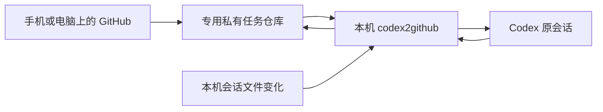

# codex2github

当前发布版本：[0.1.0](https://github.com/CircuitWizard-SI/codex2github/releases/tag/v0.1.0)。使用 `codex2github --version` 查看已安装版本。

把 GitHub Issue 当作本机 Codex 的远程会话入口。用手机浏览器继续已有会话、切换模型、引导正在执行的任务，或把下一条消息排队。

这是供用户自行部署的裸项目模板：只包含通用源码、合成数据测试、示例配置、部署脚本和文档。下载或安装本身不会读取会话或上传历史；仓库不包含任何人的会话、运行配置、数据库、日志、任务结果或凭据。

用户部署时创建自己的专用私有任务仓库，运行程序后自动读取当前用户的 `CODEX_HOME`，未设置时读取当前用户的 `~/.codex`。程序拒绝向本源码仓库及 GitHub 模板仓库发送任务和历史，即使它们是私有的。已部署用户继续使用原来的私人任务仓库，无需迁移或重新绑定会话。

[](https://github.com/CircuitWizard-SI/codex2github/actions/workflows/tests.yml)
[](LICENSE)

当前是 Windows 优先的早期版本，移动端使用 GitHub 网页。独立移动端 App 和桌面客户端尚未实现；后续接入方向见 [路线图](docs/ROADMAP.md)。

## 能做什么

- 在 GitHub 中选择本机原会话，保留同一会话 ID 和历史上下文。
- 通过 `/model` 切换当前 Issue 绑定会话的模型；本机路由变化后该覆盖自动失效并跟随新默认模型。
- `/effort` 查看思考档位，`/effort xhigh` 调整当前对话；也支持 `/model 模型ID 档位` 一起选择。
- `/steer` 给当前执行轮次追加引导；送达卡显示已读、已提交、已接收和待确认。
- `/queue` 排队或查看队列，`/cancel` 撤回等待消息。
- 本机文件通知触发会话目录及历史更新，合并连续写入；子代理独立分类。
- 任务完成、回复结束或执行失败后保持 Issue 打开，只有用户明确要求才关闭。
- 可启用完成通知：任务结果发布后，GitHub Actions 单独 @仓库拥有者，供 GitHub Mobile 推送。

已有会话先通过 Windows Desktop 的会话接口应用并读回目标对话的模型和档位，再通过 Codex 官方 `queue` CLI 提交原文。该接口仅能调整下一轮的 `model`、`effort`，不能修改全局配置、路由或权限。桌面端正在执行的一轮继续完成；接口不可用时回退到 CLI app-server，写入冲突会自动等待。

监听和同步使用本机文件／数据库与 GitHub 接口，不调用模型。实际对话和任务执行才使用模型额度。



## 快速开始

需要 Windows、Python 3.11+、已登录的 [GitHub CLI](https://cli.github.com/)，以及已配置模型且支持 `app-server` 的 [Codex CLI](https://developers.openai.com/codex/cli/)。桥接器只读取本机 Codex/CC Switch 路由，并通过 Codex CLI 执行。

### 1. 下载和安装

```powershell
git clone https://github.com/CircuitWizard-SI/codex2github.git
cd codex2github
python -m venv .venv
.\.venv\Scripts\python.exe -m pip install -e .
gh auth login
```

### 2. 建立自己的私有任务仓库

源码模板仓库只用于分发程序和反馈。远程留言、会话目录和历史使用部署者自己的**专用私有任务仓库**。不要把本源码模板或其带有问题反馈表单的副本作为任务入口：

```powershell
gh repo create YOUR_USER/codex-tasks --private
.\.venv\Scripts\python.exe -m codex2github init --repo YOUR_USER/codex-tasks
```

把 `YOUR_USER` 换成自己的 GitHub 用户名。模型始终读取本机当前 Codex/CC Switch 路由，不写入桥接器配置。配置写入本项目 `config.json`，输出和运行状态分别默认放在 `workspace/`、`.runtime/`。

**同步范围**：启动 `watch` 会识别并同步当前部署者本机的全部可读会话历史，包括归档会话和子代理会话，上传到上面指定的私有任务仓库。对话中出现的源码、文件路径及未被规则识别的敏感文字也可能随历史上传。部署前应确认自己接受这个范围；源码模板不会收到这些内容。

### 3. 检查和启动

```powershell
.\.venv\Scripts\python.exe -m codex2github doctor
.\.venv\Scripts\python.exe -m codex2github setup
.\.venv\Scripts\python.exe -m codex2github notifications enable
.\.venv\Scripts\python.exe -m codex2github watch
```

`setup` 会打印私有仓库的会话入口 URL。打开该 Issue，在评论框发送 `/session 会话名或ID`，收到连接确认后直接留言。新建 Issue 也可以启动新任务，无需添加标签。

保持电脑在线和监听器运行。GitHub 留言约每 15 秒读取；本机变化由文件事件触发，历史发布最短间隔 30 秒，15 分钟兜底检查。关闭前台监听器可按 `Ctrl+C`，已启动的任务继续执行。

后台启动可使用 `scripts/start.ps1`。此项目不自动安装系统服务或开机启动项。

### 任务完成通知

`notifications enable` 只在你的私有任务仓库安装独立的 Actions 工作流。完整任务回复仍由当前账号发表；工作流看到真正的最终回复后，以 `github-actions[bot]` 追加一条 @你的简短提醒和结果链接。排队回执、模型查询和引导卡不通知，启用时不会补发旧任务。

手机安装 GitHub Mobile，在“设置 → 通知”开启 **Direct mentions（直接提及）**，并允许系统通知。只用手机浏览器不会自动获得 GitHub Mobile 推送；推送仍受手机权限、勿扰和工作时段设置影响。

需要仓库允许 GitHub Actions，并且当前 GitHub CLI 凭据有写入工作流的权限。工作流不检出仓库，不执行任务文字，不调用模型，也不在日志打印对话；只读取必要的 Issue／评论并追加通知。它不编辑或删除评论，不改变仓库默认 token 权限。单个任务工作流使用 `issues: write`，GitHub 不提供更细的“只新增评论”权限。私有仓库运行工作流会使用 GitHub Actions 额度。

`notifications disable` 只停用通知工作流，聊天和历史同步继续工作。通知失败不会重新执行任务；可在仓库 Actions 页面重新运行失败的通知，程序会检查已有提醒避免重复。只想验证手机通知时，可对一个已有最终回复运行 `notifications test --issue ISSUE_NUMBER --comment FINAL_COMMENT_ID`，提醒明确标记为“通知测试”。

## 评论指令

| 指令 | 行为 |
|---|---|
| `/session 会话名或ID` | 连接已有原会话，也支持唯一 ID 前缀 |
| `/model 模型ID [档位]` | 修改当前对话后续任务的模型和可选档位；路由变化后覆盖自动失效 |
| `/models` | 只读查询当前路由的模型目录及本机已标注的思考档位 |
| `/effort`、`/reasoning` | 查看当前档位和当前模型支持的档位 |
| `/effort xhigh` | 仅调整当前对话的思考档位 |
| `/effort auto` | 清除当前对话的档位覆盖，跟随本机默认 |
| `/steer 内容` | 引导当前执行轮次，卡片显示送达状态 |
| `/queue 内容` | 当前回复结束后按顺序执行 |
| `/queue` | 查看当前 Issue 的等待队列和消息 ID |
| `/cancel` | 撤回最近一条等待消息 |
| `/cancel 消息ID` | 撤回指定等待消息 |
| `/cancel all` | 撤回当前 Issue 全部等待消息 |
| `/status`、`/help` | 查看状态和用法 |
| `/close` | 按用户明确要求关闭当前 Issue |

普通留言默认排队。引导沿用当前轮次的模型和档位，排队消息保存发送时的模型、档位与目标。模型目录未标注档位时会明确提示，实际支持范围由执行器校验。绿色“会话已接收”表示执行器或原历史确认收到该条引导，不表示要求已完成。

`/steer 内容` 在原会话正在执行时直接送入当前轮次，包括通过 CLI queue 交给 Desktop 的任务。程序从原始会话日志识别活动轮次，再通过原会话所有者调用同轮引导接口；独立 CLI app-server 任务继续使用 `turn/steer`。不会把入队回执误判为空闲，也不会在超时或轮次无法确认时自动改为排队。只有确认会话空闲时，`/steer` 才作为下一条任务处理；明确需要下一轮时使用 `/queue`。

已有会话收到的“已提交”回执表示 Codex 已接受留言，尚未完成；监听器会继续只读跟踪对应轮次，完成后自动在原 Issue 发表最终回复。完整历史同时读取本机数据库和原始会话文件，避免数据库投影延迟导致内容遗漏。恢复旧的提交记录只补追踪与回复，不重新执行任务。

## 配置与限制

复制 [config.example.json](config.example.json) 查看字段说明，实际配置中的路径可以相对配置文件目录填写；多实例使用不同的 `--config` 文件及运行目录。认证由 `gh` 和 Codex 管理，不需要把 API 密钥写进项目配置。

桥接器不覆盖 Codex 的 sandbox、approval policy、provider、endpoint 或路由设置。历史索引跟随 Codex 内部版本，升级后可能需要适配。模型的可用性来自当前本机路由，项目不提供模型服务或密钥。

源码仓库不包含个人会话、截图、运行日志、凭据或逆向提取的桌面应用文件。历史脱敏是尽力处理，应使用仅授权自己访问的私有任务仓库；程序拒绝把会话历史发布到公开仓库。

更多内容：[配置](docs/CONFIGURATION.md) · [架构](docs/ARCHITECTURE.md) · [路线图](docs/ROADMAP.md) · [贡献指南](CONTRIBUTING.md) · [安全说明](SECURITY.md)。

每次发布项目更新时递增版本号，并同步更新包版本、更新记录与 GitHub 标签／Release；具体规则见 [版本发布](docs/RELEASING.md)。

完整首次部署步骤和可交给 Codex 的部署说明见 [部署裸项目](docs/DEPLOYMENT.md)。

## 开发

```powershell
.\.venv\Scripts\python.exe -m unittest discover -s tests -v
.\.venv\Scripts\python.exe -m pip wheel --no-deps --no-build-isolation -w dist .
```

测试使用本项目 `.test-runtime/` 下的合成数据，不请求真实模型，不操作你的任务或原会话。GitHub Actions 覆盖 Python 3.11／3.14 和 Windows／Linux；Linux 用于核心逻辑检查，实际文件监听目前只支持 Windows。

许可证：[MIT](LICENSE)。
