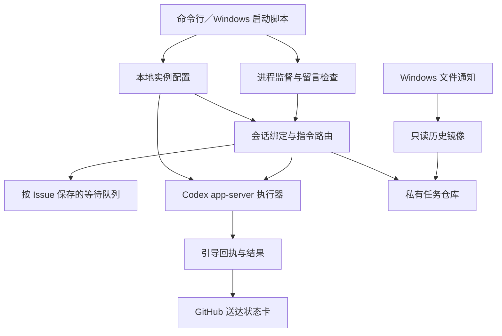

# 架构与扩展边界

当前版本把 GitHub 当作留言传输和会话入口，本机进程负责原会话执行。移动端 App 或桌面客户端可以在未来接入新的传输层，复用相同的会话、队列和执行器语义。

## 代码模块

| 模块 | 责任 |
|---|---|
| `config.py`、`cli.py` | 配置路径、命令入口和实例启动 |
| `watcher.py` | 监督留言检查与历史同步进程；退出时保留已启动的任务 |
| `conversation_router.py` | 会话选择、模型覆盖、评论去重、队列、撤回及原会话路由 |
| `worker.py`、`appserver_worker.py` | 续接原会话、执行一轮、接受同轮引导、保存和发布结果 |
| `queue_results.py` | 只读追踪原始会话中的对应任务轮次，区分提交回执与最终完成 |
| `reasoning.py` | 只读模型档位能力、默认档位解析及单会话选择校验 |
| `thread_settings.py` | 仅连接目标会话所有者，应用下一轮模型／档位或提交同轮引导；无全局配置接口 |
| `active_turn.py` | 只读原始会话最新生命周期事件，识别活动轮次，不依赖滞后的数据库投影 |
| `session_events.py` | 原生文件通知、事件合并、失败重试和恢复节流 |
| `session_sync.py` | 历史读取、分页、分类、脱敏和私有仓库 API 提交 |
| `steer_visual.py` | 纯渲染函数，按真实回执生成 GitHub 状态卡 |

## 会话与消息语义

- 会话绑定使用原 Codex UUID，不通过复制历史建立替代会话。
- 同一原会话只运行一个执行轮次；其他普通留言等待。
- `/steer` 是当前轮次的补充输入，`/queue` 是下一轮消息。
- CLI queue 提交回执与活动轮次分开识别。`/steer` 通过原会话所有者的同轮接口送入 Desktop，按原始日志中的活动轮次核对返回 ID；独立 app-server 继续使用控制信箱及 `turn/steer`。投影缺失不代表空闲；无法确认、超时和轮次不匹配均不自动转成队列，不修改任何本机全局设置。
- 排队消息保存发送时的目标会话、模型及思考档位，按顺序执行。
- 撤回只删除尚未派发的等待项，保留当前执行轮次及 GitHub 原留言。
- 消息的 GitHub 评论 ID 和固定 `clientUserMessageId` 用于去重。
- 超时的引导结果是未知状态；在原会话历史中匹配唯一消息标识后才能补确认，不自动重发。
- 子代理按 `thread_source`、结构化 `source` 和旧记录的 `agent_path` 分类。
- GitHub 任务只有显式 `/close` 或用户手动操作才能关闭。
- 模型状态由本机路由指纹控制。`/model` 只写 `.runtime/conversation-state.json` 中的当前会话覆盖；发现本机路由变化后清除全部覆盖并把等待消息改为 `auto`。执行器随后读取新路由，其他会话不会被写入或改路由。
- `/models` 与模型切换指令只读查询当前 Codex 端点的 `/models`；不可查询时读取当前路由的本机目录。成功查询的目录替代不完整快照，避免混入其它 provider 或保存的堆栈成员；空闲 watcher 不查询模型端点，也不修改本机配置。
- `/effort` 和 `/model 模型ID 档位` 保存按原会话 ID 隔离的档位覆盖；`auto` 清除覆盖。换模型清除该会话旧档位，路由变化同时清除全部档位覆盖及等待消息旧档位。能力来自当前路由本机目录，未标注时保留明确提示。
- 已有 Windows Desktop 会话先通过 `thread-follower-update-thread-settings` 只应用目标会话下一轮的 `model`、`effort`，再读回确认，之后调用官方 `queue` CLI 提交原文。CLI 的 `--model`、`-c model_reasoning_effort` 不会随队列请求传递，不能作为成功依据。设置接口没有 `config/*`、权限写入或当前轮次更新能力；watcher 不调用此写接口。接口不可用时使用 CLI 独立 app-server；writer 冲突会恢复未提交留言并等待。独立执行路径在 `turn/start` 明确发送 `effort`。
- CLI 入队回执只表示提交成功。路由器保留对应 job，按提交前日志边界、消息内容或原生 client ID 定位轮次，等到该轮次的最终消息与完成事件后才发布结果。读取游标保存在桥接器状态中，工具输出和其它轮次的回复不参与匹配。中断会明确说明，不重新提交原留言。
- 最终回复发布失败时保留任务；已被 GitHub 接收但响应丢失时，通过固定结果标记找回原评论，避免重复回复。旧版本遗留的入队文件会恢复完成追踪，保持原任务不重跑。
- 历史镜像合并 SQLite 投影和原始 JSONL（含压缩记录），补齐两种来源中各自缺失的可见消息。原生 `item_completed` 的消息阶段用于补全进度标识；重复表示只保留一份，不导出内部推理和工具内容。

## 运行数据

`.runtime/conversation-state.json` 保存绑定、模型及档位覆盖、当前路由指纹、评论游标、队列、撤回记录和引导回执；`jobs/` 保存每个请求的提示、结果、控制信箱和完成状态；`repository/` 保存生成的历史镜像。它们不属于公开源码。

当前实现按配置文件初始化进程内设置，JSON 状态由单个路由进程和文件锁管理。未来客户端不能直接并发写这些文件，应先增加稳定的服务接口、认证和原子状态访问。

## 未来客户端接入

后续先从路由器提取独立的会话和任务服务，再定义认证后的命令接口：选择原会话、提交下一轮消息、引导当前轮次、查看／撤回队列及读取送达状态。GitHub 将成为其中一个传输适配器，移动端与桌面端使用相同的服务语义。

当前没有 HTTP 服务、移动端 UI、桌面客户端或版本化客户端 API；这里描述的是扩展方向，不是已经交付的接口。
